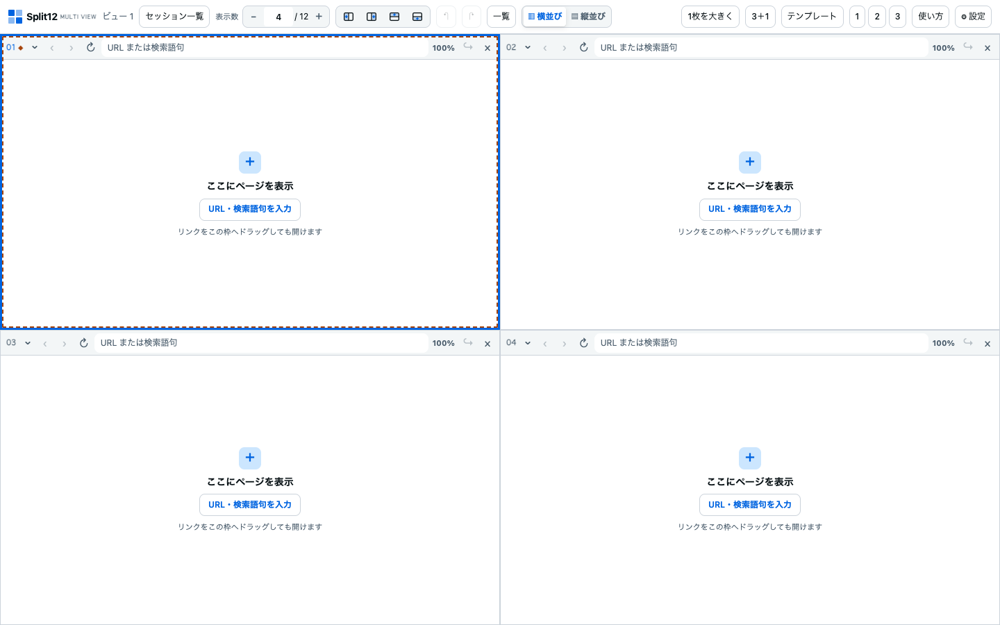

# Split12

Chrome のひとつのタブに、Web ページを 1〜12 枚並べる拡張機能です。ペインごとにアドレスと履歴を持ち、配置や大きさ、表示倍率、最大化を切り替えられます。



## インストール

Node.js 20 以降と Chrome 128 以降が必要です。ターミナルでこのフォルダを開き、以下を実行します。

```sh
npm ci
npm run build
```

1. Chrome で `chrome://extensions` を開き、右上の「デベロッパー モード」をオンにします。
2. 「パッケージ化されていない拡張機能を読み込む」を選び、このフォルダの `dist/` を指定します。
3. 拡張機能の一覧から Split12 をツールバーに固定すると、開きやすくなります。

拡張機能のアイコンを押すか、`Alt + Shift + 8`（Mac は `Option + Shift + 8`）で開きます。ショートカットは `chrome://extensions/shortcuts` から変更できます。Split12 は1つのウィンドウに1つです。押したウィンドウに Split12 があればそれを前面に出し、なければ押したタブの隣に新しい分割ビューを開きます。

## 使い方

- 操作を思い出したいときは、右上の「使い方」を押してください。対象のボタンを囲む9ステップのツアーで、表示数の増減、分割、タブの追加、新しいビュー、戻る・進む、閉じる、配置を確認できます。「次へ」「戻る」または左右キーで進み、「ツアーを終了」または Esc で閉じます。何度でも開き直せます。ツアーを見るだけではページや配置は変わりません。
- 「表示数」に1〜12を入力してEnterを押すか、＋／−で既存の配置を保ちながら枠を増減します。均等に並べ直すときは横並び・縦並びを押します。「3＋1」では上に3枚、下に横長の1枚を置けます。
- 枠の左上の番号を右クリックし「固定タブに選択」を押すと、追加の基準になる固定枠を指定できます。番号をフォーカスして Shift+F10 でもメニューを開けます。上部の「左・右・上・下に追加」は固定枠を分割します。固定枠は破線と◆、操作中の選択枠は青い枠線で示し、別の枠をクリックしても固定先は変わりません。
- 境界線のドラッグは一方向、境界の交点のドラッグは縦横同時に大きさを変更します。近くの隣接境界にはガイドを出して吸着します。Alt / Option を押しながら動かすと一時的に吸着を解除できます。境界をダブルクリックするとその両側を反転します。枠番号を別の枠の中央やヘッダーへドラッグすると交換し、境界線へドラッグするとその間に移動できます。枠のページ部分の辺の内側へドラッグすると、その枠を半分に分けて配置します。画面外周のごく端へドラッグすると全体の外側へ移動します。色付きのプレビューで移動後の位置を確認できます。
- 「テンプレート」の「現在の配置を保存」で、現在の枠数・向き・配置を新規保存し、一覧から適用・上書き・削除できます。保存済みの名前をダブルクリックすると編集でき、Enterで変更を保存します。「テンプレート候補作成」は指定枚数の配置案を表示し、適用を押すまで現在の配置を変更しません。テンプレートはビューと別に保存し、URL・倍率・固定／選択枠・履歴を含みません。適用後も表示中のページは維持され、非表示になった枠の URL は残ります。
- テンプレート画面で保存済みの配置を3つのショートカットに割り当てると、上部の「1」「2」「3」ボタンから適用できます。
- 上部のSplit12ロゴを押すとツールバーを閉じ、画面左上の小さなボタンで再表示できます。Option / Alt＋Shift＋Hでも開閉でき、Chromeのショートカット設定から別のキーも割り当てられます。枠を最大化すると自動で閉じ、最大化を解除すると再表示されます。
- 各枠の番号の右側に、Chromeで利用できるサイトアイコンを表示します。
- `Option + Shift + ↑` / `Option + Shift + ↓` で分割数を増減できます。設定画面の「キーボードショートカット」で現在の割り当てを確認し、「ショートカットを変更」から Chrome の設定画面で変更できます。OSや他の拡張機能の割り当てと重なる場合は、空いているキーに変更してください。
- 「セッション一覧」の「➕追加」で新しいビューを作り、今のタブをそのビューに切り替えます。右上の×で一覧を閉じられます。行をクリックして選択し、ダブルクリックで今のタブに表示します（別のウィンドウで開いているビューなら、そのウィンドウを前に出します）。切り替える前のビューの内容は保存されます。名前は「✏️命名」、F2、右クリックの「名前変更」で変更できます。どのタブでも開いておらず全部の枠が空のビューは、一覧から自動で削除します。「📖編集」を押すと各行にチェックと移動ハンドルが出て、「選択を削除」でまとめて削除できます。名前をドラッグして別の行で離すとその2つだけを入れ替え、☰ をドラッグすると間に移動します。並び順は保存されます。閉じたビューも同じ内容で再開できます。最後のビューを削除した場合は空のビューが開きます。各ビューの表示内容とレイアウトは別々に保存され、同じビューURLの複製も独立したコピーになります。一覧の表示・非表示は保存されます。
- アドレス欄には、開いているタブ・Split12に保存したURL・Chromeの閲覧履歴（題名付き、よく見るページが上）・よく使うサイト・Google検索の候補を表示します。日本語入力の変換中も候補が出ます（Enterは確定後に効きます）。上下キーとEnter、または候補のクリックで開けます。Escで候補を閉じます。履歴の検索は端末内で行い、候補取得のために入力途中の文字を外部へ送信しません。
- 各ペインのアドレス欄に URL を入力して Enter を押します。`example.com` は `https://`、`localhost` と `127.0.0.1` は `http://` を補います。`Gmail` のような検索語句を入力すると、候補の「Google で「…」を検索」が最初から選ばれ、Enter で入力したSplit12の枠内に検索結果を開きます。候補が出る前に Enter を押した場合は入力エラーの「Google で検索」から検索できます。「現在のページに戻る」で入力エラーを閉じ、元のページを操作できます。
- 空の枠には「URL・検索語句を入力」ボタン、開いているタブの一覧、リンクをドラッグして開ける案内を表示します。一覧からタブを選ぶとその枠に開き、読み込めたら元のタブを閉じます（固定タブと読み込めなかったタブは残します）。
- 枠の左上のサイトアイコンも番号と同じく、ドラッグで交換・移動、ダブルクリックで最大化、右クリックでメニューを使えます。
- 上部の「1枚を大きく」で、選んでいる枠を左（縦並びでは上）に大きく置き、残りを均等に並べます。
- 枠の番号の右にある「▾」（枠のメニュー）で、番号の右クリックと同じメニューを開けます。メニューの「最大化」「最大化を解除」で枠を最大化できます。枠が細いときは、新しいタブで開く、倍率と戻る進む、再読み込みを幅に応じて順に隠し、このメニューから使えるようにします。
- 各ペインのボタンで、戻る・進む・再読み込み・閉じるを操作できます。枠の左上の番号をダブルクリックすると最大化でき、もう一度ダブルクリックするかEscキーを押すと元に戻ります。枠内ページや開いているメニューがEscを使うときは、そちらの操作が優先されます。矢印ボタンは現在のページを同じChromeウィンドウの背景の新しいタブで開き、分割画面と元の枠を表示したままにします。「×」で枠を閉じると表示数が1減り、後ろの番号が詰まります。最後の1枠は空になります。細い枠ではヘッダーの右クリック「タブを削除」も使えます。「この枠を空にする」は枠数を保ってページだけ閉じます。
- 上部の「一覧」では枠番号・サイトアイコン・ページ名・URLを確認でき、×で枠を閉じるか、ゴミ箱で枠を残したままページを空にできます。行をダブルクリックすると最大化できます。行にカーソルを合わせると左に出るハンドルをドラッグして、枠の位置を変えずに番号を順送りできます。ページ名を取得できない場合はホスト名を表示します。セッションのビューを右クリックすると一覧、名前変更、削除を選べます。別ビューの一覧で行をダブルクリックすると、そのビューに切り替えてその枠を最大化します。閉じる・空にするはそのビューを開いてから使えます。新しくできたビューには、一覧にない番号の「ビュー N」を付けます。
- ツールバーの「↶」「↷」で、枠の追加・閉鎖、配置、リサイズ、反転、倍率などを戻す・やり直すことができます。閉じた枠のURL・倍率・ページ履歴も復元します。ページ内のフォームやスクロール位置まで復元する機能ではありません。履歴はビューごとに最大50操作で、再読み込みするとリセットされます。
- 境界をShift＋クリックすると、最初に選んだ方向と同じ境界だけを複数選択できます。もう一度押して解除し、Escで全解除します。選択した線を通常ドラッグすると、選択全体が同じ量だけ動きます。選択した線をダブルクリックするとまとめて反転します。親子の境界も対応し、端では枠が潰れない範囲で止まります。1回の一括操作はUndo1件で戻せます。
- ログイン専用ボタンと専用の再読み込み機能は撤去しました。Google などの認証ページと認証用ポップアップを自動で分割ペインに取り込まない動作は維持しています。
- ドメインの名前解決に失敗した場合も「Google で検索」が使えます。この場合、検索するのはホスト名だけで、結果も同じ枠で開きます。
- ペインの「100%」ボタンから30〜300%の10%刻みを選べます。旧バージョンの67%も引き続き選択でき、保存された値も保たれます。`⌘ + Shift + 引用符（'）` で選択中の枠を10ポイント拡大し、`⌘ + Shift + セミコロン（;）` で縮小できます。日本語配列でセミコロンキーが「+」を生成しても縮小を優先します。
- 0.1.6以前に戻す場合、固定枠の設定は使われず、旧版にない倍率は100%に戻ることがあります。旧版で設定を保存すると、その状態で上書きされます。
- 枠番号を右クリックし「開いているタブから追加」で現在のウィンドウのページを選べます。表示中や重複する URL は候補から除かれます。リンクの右クリック「リンクを分割ビューで開く」では、固定枠の左・右・上・下への追加を選べます。追加時は原則として枚数を増やします。12枠とも埋まっていれば追加しません。
- 枠の中のページにあるリンクをつかんで動かすと、Split12 がそのドラッグを引き受け、数字のドラッグと同じ表示（境界線の強調、色付きのプレビュー、固定タブ隣の追加枠、リンク名の付箋）が出ます。離した場所に新しい枠を1つ追加してリンク先を開き、元のページはそのまま残ります。元の枠の中央で離すか Esc を押すと中止です。Shift を押しながらつかむと Chrome 本来のドラッグになり、別のウィンドウへ持ち出せます（Chrome は同じタブ内で別サイトへのドラッグを受け付けないため、分割画面には落とせません）。
- 別のウィンドウ、ブックマーク、Finder などタブの外から URL やリンクをドラッグ＆ドロップした場合も、落とした場所に新しい枠を1つ追加してリンク先を開きます。既存の枠とページはそのまま残り、表示中のページを置き換えることはありません。境界線、枠の辺、画面の外周のほか、ドラッグ中に固定タブの隣へ現れる「固定タブの○に追加」の枠に落とせます。読み込み済みの枠の中央に落とした場合も固定タブと同じ方向に枠を追加し、空の枠に落とすとその枠で開きます。うまくいかないときは、設定の「表示」で「ドラッグ診断を左下に表示する」を入れると、版番号と受け取った種類、追加先を確認できます。ペイン内のリンクを Command＋クリックしたり、新しいタブで開くリンクを選んだりした場合は、通常のタブのまま残り、自動では取り込みません。必要なときは枠番号のメニューの「開いているタブから追加」か、空の枠に出る一覧から追加できます。別ウィンドウのポップアップもそのまま開きます。
- 枚数を減らすと非表示のペインの URL は保存され、枚数を戻すと再び読み込みます。新しいページを追加すると、保存済みページは後ろへ移して保持し、空きがあれば表示数を1枚増やします。非表示を含む全枠に保存済みページがある場合は、表示中の空欄を使います。
- URL を直接開くと、そのホストは埋め込み許可リストに入ります。リンク先が埋め込みを拒否する場合は、ペインの案内から許可するか、通常のタブで開けます。「設定」で許可を削除すると、次の読み込みから反映されます。
- 枚数、並び方、固定枠、各 URL、倍率と許可リストは Chrome 内のローカルストレージに保存します。操作中の選択枠、ペイン内の閲覧履歴と最大化状態は保存しません。

### キーボード操作

Macでは⌘、Windows/LinuxではCtrlを主な修飾キーに使います。ChromeやOSが優先するキーはページに届かない場合があります。Windows/LinuxのCtrl+−はブラウザのズーム操作とも重なります。その場合はボタン、または「ショートカットを変更」から別の拡張ショートカットを割り当ててください。Chromeは新規ウィンドウ・タブ切替等の予約キーを優先するため、⌘+Nや⌘+Shift+[ / ]の実機での動作は保証できません。[Chrome公式のコマンド仕様](https://developer.chrome.com/docs/extensions/reference/api/commands)に従い、既定キーは4件までとしています。

| 操作 | ビューが受け取れるキー | 代替 |
|---|---|---|
| 新しいビュー | ⌘/Ctrl+N | Option/Alt+Shift+N、ボタン |
| 一覧を開閉 | ⌘/Ctrl+B | セッション一覧ボタン |
| 一覧の上下へフォーカス移動 | ⌘/Ctrl+↑ / ↓ | 一覧内の↑ / ↓。Enterで開く |
| 固定枠を長辺方向に分割し1枠追加 | ⌘/Ctrl+Option/Alt+N | 左・右・上・下に追加ボタン |
| 選択枠を閉じる | Ctrl+Shift+D（Macでは変更可能なコマンドを設定） | ×、ヘッダーの右クリック |
| 固定枠の上・左・下・右へ追加 | ⌘+Shift+W / A / S / D | 四方向の追加ボタン。Chrome/OS優先の場合は代替キーを設定 |
| 選択枠の倍率を10%ずつ変更 | ⌘+Shift++ / ⌘+Shift+- | 枠ごとの倍率メニュー |
| 配置・枠数を戻す／やり直す | ⌘/Ctrl+Shift+[ / ] | ↶ / ↷ |
| その枠のページを戻る／進む | Ctrl+− / Ctrl+Shift+− | 枠の‹ / › |

サイト内では枠の選択・削除・分割・倍率・ページ履歴・配置履歴を橋渡しします。サイト側のN・B・↑↓・Kや、Split12入力欄のB・↑↓は横取りしません。⌘/Ctrl+Kは変更していません。

## 権限の用途

| 権限 | 用途 |
|---|---|
| `declarativeNetRequestWithHostAccess` | 許可されたサイトの埋め込み拒否ヘッダーを、分割ビューのサブフレームに限って調整するため。 |
| `webNavigation` | ペインごとの読み込み、リンク移動、エラーと履歴を識別するため。 |
| `storage` | レイアウトと許可リストをローカルに保存するため。 |
| `contextMenus` | ページやリンクを右クリックから分割ビューに追加するため。 |
| `tabs` | 既に開いている分割タブの URL と読み込み中の URL を確認し、重複を防ぐため。Chrome の仕様上、この権限は他のタブの URL・タイトルも読み取れる権限です。 |
| `history` | アドレス欄の候補に Chrome の閲覧履歴のページを題名付きで出すため。入力中の文字で端末内の履歴を検索するだけで、履歴の内容も入力中の文字も外部へ送りません。 |
| `favicon` | 各枠の番号横にChromeのサイトアイコンを表示するため。 |
| `browsingData` | 許可済みのサイトがペインで埋め込みを拒否されたとき、そのサイトのサービスワーカーだけを削除して1回読み直すため。サービスワーカーが返す応答には分割タブ限定のルールが効かないためです。削除するのは許可リストにあるサイトのサービスワーカーだけで、Cookie や閲覧履歴は消しません。そのサイトの Web 通知は、次にそのサイトを開くまで止まることがあります。 |
| `cookies` | 権限上はホスト権限のある HTTP / HTTPS サイトの Cookie にアクセスできます。実装では、許可済み X の直接のペインと同じ Cookie ストアにある、非 HttpOnly・Secure な `ct0` だけを読み取り、投稿取得の CSRF 認証を補います。Cookie の値や属性は書き換えず、保存・ログ出力もしません。 |
| `scripting` | 上記の補完値を、登録済み分割タブにある X の対象文書だけに渡すため。通常タブ、未登録ページ、入れ子 iframe、他オリジンは対象外です。 |
| `http://*/*`, `https://*/*` | 選択した Web ページをペインに表示し、分割タブ内の許可ルールを適用するため。 |

HTTP / HTTPS ページにはドラッグ開始・終了を知らせる小さなスクリプトが読み込まれます。分割ビュー内ではクリックと割り当て済みショートカットを検出し、一覧表示のためページタイトルを取得して保存します。分割ビューのフレームからの通知だけを処理し、ドラッグの内容や通常の入力文字は送信しません。

`tabs` を追加した理由: HTTP / HTTPS のホスト権限だけでは、Chrome がこの拡張機能自身の `chrome-extension://` ページの URL を `tabs.get` で返さず、分割タブの再利用を確実に判定できなかったためです。

## 制限と安全上の注意

- サイト自体の JavaScript が埋め込みを拒否する場合（Google のログイン画面など）は表示できません。その場合は「新しいタブで開く」を使ってください。
- 普通のタブでログインしておくと、ペインでもログイン状態を利用できるサイトがあります。ただしブラウザやサイトの Cookie・ストレージ設定により動作は異なり、保証はできません。
- ペインの JavaScript からは `SameSite=Lax` / `Strict` の Cookie が見えない場合があり、一部のサイトで送信操作などが失敗することがあります。
- 0.1.2 の X 対策は、許可済み `https://x.com` の直接のペインだけを対象にします。`ct0` の読み取りを補い、X 自身の `/i/api/` への fetch・非同期 XHR の CSRF ヘッダーを整合させます。DNR の適用範囲は変えません。利用者から X が開き、NotebookLM も Google アカウントでログインできたとの報告を受けています。note の実アカウントでのログイン確認は残っています。
- ペイン内のリンクを開いた後、Chrome 本体の「戻る」は最後に動いたペインを戻すことがあります。特定のペインを戻すときは、そのペインのボタンを使ってください。
- 許可されたサイトは、**分割タブ内**では別のサイトからも埋め込める状態になり、クリックジャッキングへの耐性が下がります。通常のタブにはこの解除を適用しません。
- 許可されたサイトの CSP に `frame-ancestors` が含まれるときは、分割タブ内ではその CSP ヘッダー全体が除去されます。`script-src` など同じヘッダー内の他の制限も一緒に外れる点に注意してください。
- 埋め込みページの最上位ページへの移動は sandbox で制限します。一部のサイトや認証フローは、その制限によって利用できない場合があります。

## 開発とテスト

実ブラウザテストには Playwright の Chromium が必要です。初回のみ、次を実行します。

```sh
PLAYWRIGHT_BROWSERS_PATH=.playwright-browsers npx playwright install chromium
npm run check
```

`npm run check` は型検査、単体テスト、ビルド、Playwright E2E の順に実行します。ブラウザはリポジトリ内の `.playwright-browsers/` に置き、各 E2E は独立した一時プロファイルを使います。`npm run test:e2e` で E2E だけを実行できます。

Playwright の起動設定は Chrome の通常利用時とストレージの分離設定が異なるため、以下のログイン・Cookie 動作は実機で確認してください。

## 実機での確認

- [ ] アイコンとショートカットで、Split12 のあるウィンドウではそれが前面に出て、ないウィンドウでは押したタブの隣に新しいビューが開く。
- [ ] 1〜12 枚と横並び・縦並びを切り替え、枠の重なりや隙間がない。
- [ ] ページを表示したまま配置を変えても、残るページが再読み込みされない。
- [ ] 複数ペインでリンクをたどり、片方の戻る・進むが他方に影響しない。
- [ ] 埋め込みを拒否するサイトについて、許可後に表示できるかを確認する。
- [ ] 設定でホストを削除した後、再読み込みで保護が再び有効になる。
- [ ] 通常のタブで埋め込み拒否が維持される。
- [ ] 利用するサイトのログイン状態、Cookie、フォーム送信を確認する。
- [ ] ペインの最大化と復帰、倍率変更、右クリック・タブから追加を確認する。
- [ ] Chrome を再起動し、レイアウト・URL・許可リスト・倍率が復元される。

### ドラッグと右クリック（自動テストでは確認できない項目）

自動テストは合成入力のため、以下は実際のマウスで確認してください。2 枚以上表示し、ペイン 1 にリンクのあるページ、ペイン 2 に別のページを表示した状態から始めます。

- [ ] ペイン 1 のリンクをドラッグし、ペイン 2 の上で 3 秒ほど止めてから離すと、ペイン 2 はそのままで新しい枠にリンク先が開く。Shift を押していても置き換わらない。
- [ ] X の投稿のリンクカードを境界線・枠の辺・固定タブ隣の追加枠へドラッグすると、新しい枠にリンク先が開き、右上の「ドラッグ診断」に受信した種類と追加先が出る。
- [ ] 同じドラッグの途中で Esc キーを押して離した後、各ペインのページをすぐにクリック・スクロールできる。
- [ ] リンクをブラウザの外までドラッグして離した後、ウィンドウに戻ってページを操作できる。
- [ ] 別のウィンドウや Finder からリンク（URL）をペイン 1 の上へドラッグし、3 秒ほど止めてから離すと開ける。
- [ ] 同じ外部ドラッグを Esc キーで中止した後、マウスを少し動かすとすぐにページを操作できる（動かさない場合も数秒で戻る）。
- [ ] ペインに新しいページが表示された直後に、すぐリンクをクリックまたはドラッグしても、1 回目の操作で反応する。
- [ ] ペイン内のリンクを右クリックし、Chrome 標準の、リンクを新しいタブで開く項目を選ぶと、分割ビューの新しいペインに追加される。失敗した場合も新しいタブが残る。
- [ ] ペイン内のリンクを右クリックし、Split12 の「リンクを分割ビューで開く」から左・右・上・下を選ぶと、その方向の新しいペインで開く。
- [ ] ⌘+N、⌘+Shift+W/A/S/D、⌘+Shift+[ / ]、Ctrl+− / Ctrl+Shift+−を実際のキーボードで試し、予約キーに取られる操作には代替キーを割り当てる。
- [ ] サイトのエディターで⌘+B、⌘+↑↓、⌘+Kが従来どおり動き、Split12の入力欄でもキャレット移動を妨げない。
- [ ] ヘッダーの右クリック削除とUndoで枠・URL・倍率が復元し、セッション一覧から閉じたビューを再開できる。

### 固定枠と選択枠・リサイズ・倍率（0.1.7）

- [ ] 1番以外の枠の番号を右クリックして固定し、別の枠の中をクリックしても固定表示が変わらない。固定設定だけでは選択枠が変わらない。
- [ ] 固定した枠の左・右・上・下にそれぞれ枠を追加できる。境界線は一方向、境界の交点は縦横同時に動き、Undoで戻せる。
- [ ] Macで選択枠に対して `⌘+Shift+＋ / −` を押すと、その枠だけ10ポイント変わる。倍率メニューで同じ値が選ばれ、再読み込み後も保持される。

### 枠の操作と設定（0.1.9.3）

- [ ] 数字同士のドラッグで枠を交換し、数字を境界線にドラッグしてその間に移動できる。境界線自体のドラッグでサイズを変えられる。
- [ ] 数字をダブルクリックして最大化・復帰できる。矢印でページが同じウィンドウの背景の新しいタブに開き、分割画面と元の枠が残る。
- [ ] 「セッション一覧」の「追加」からビューを追加し、右側の「設定」からショートカット一覧と変更画面を開く。

### 入力候補と境界の一括操作（0.1.6）

- [ ] URL欄にドメインや検索語句を入力し、候補をクリック／上下キー＋Enterで選べる。Escで閉じ、日本語変換の確定Enterでは移動しない。
- [ ] 「Googleで検索」と検索候補が同じ枠で開き、別のChromeタブや枠が増えない。Google側の認証・同意・アクセス確認が表示された場合は、そのサイトの案内に従う。自動検証ではアクセス確認が出たため、利用者の通常環境での検索結果表示は別途確認する。
- [ ] 同じ向きの境界をShift＋クリックで選び、選択した線をドラッグするとまとめて動く。選択した線のダブルクリックでまとめて反転し、Undoで1操作ずつ戻せる。

分割枠内のリンクから新しいタブを開いた場合、そのタブは自動では分割枠に取り込まれません。必要に応じて枠番号の右クリックから「開いているタブから追加」を選べます。四方向のショートカットは設定からChromeのショートカット設定で変更できます。Macでは既定のキーをChromeやOSが優先して実行する場合があります。

上部の四方向追加ボタンを右クリックすると、右クリックメニューの「リンクを分割ビューで開く」で追加する方向を固定できます。固定中はボタンが強調され、同じボタンをもう一度右クリックすると解除できます。個別に方向を指定した場合は、その指定が優先されます。

分割ビューのタブを閉じた際、非表示の枠も含めてすべて空であることを確認できたビューは、セッション一覧から自動削除されます。ページが残っているビューや、状態を確認できないビューは保持します。
